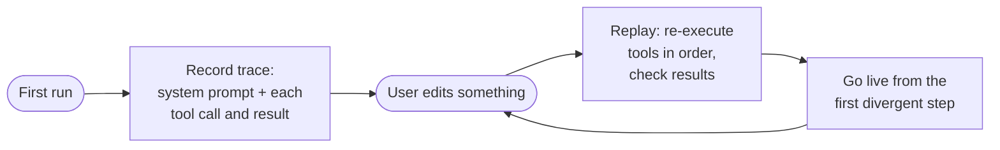
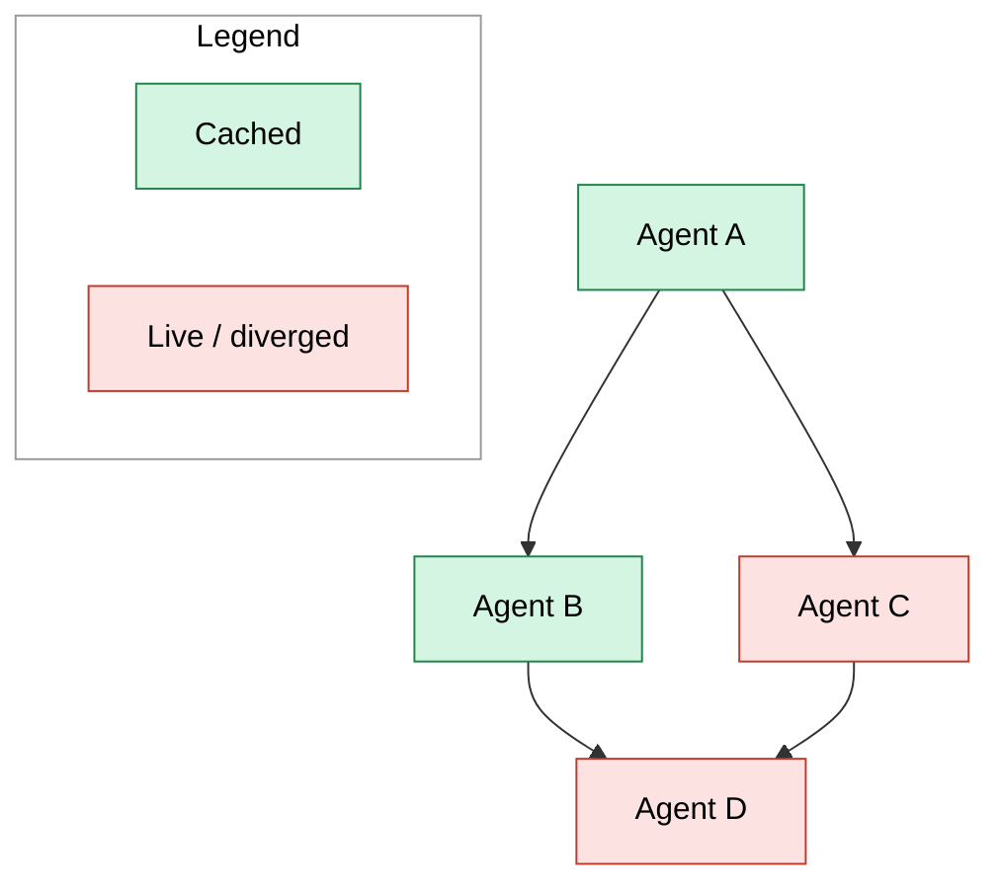
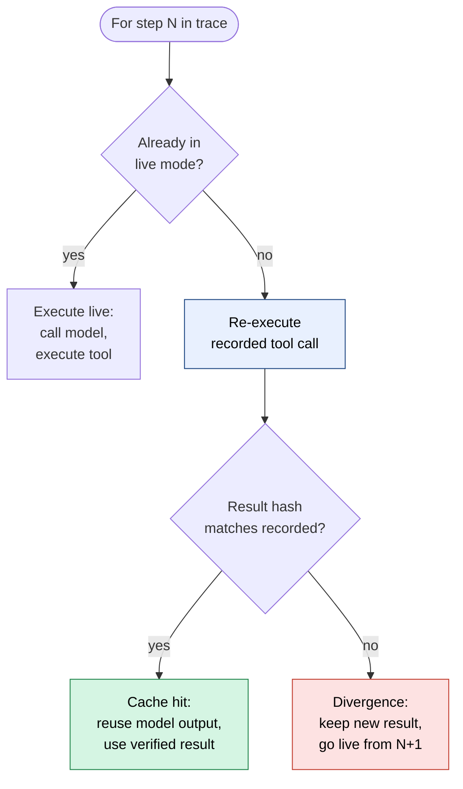
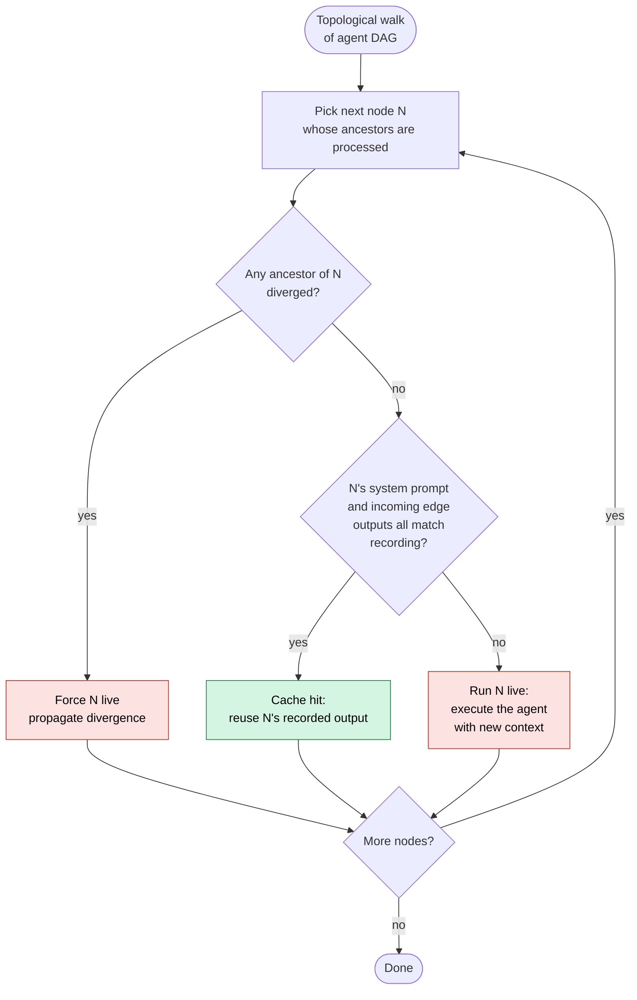

# Incremental Agent Replay: A Design Proposal

## 1. Background

Building any non-trivial agent system involves an iteration loop: change something — a tool definition, a system prompt, a memory module, a skill, a rule set — run a test task end-to-end, observe the agent's behavior, change again. Each run can take minutes. The agent issues many model calls and tool calls, and most are unaffected by any given change. Re-running the entire task wastes time on early steps that have nothing to do with the edit.

This document describes a system that, after a change, re-runs the test task by reusing as much of the previous run as is provably safe — only re-executing from the point where behavior actually diverges. The mental model is **incremental compilation**: track dependencies, invalidate only what's downstream of a change, recompute the rest.

The proposal is general. It applies whenever an agent runs a task by interleaving model calls and tool calls. It is not tied to skills, or to any particular framework. Skills, memory, tools, rules, prompts — they all fit the same model.

---

## 2. Two Facts About Agent Runs

Two observations, neither novel, but together they pin down the entire design.

### Fact 1. Everything that enters an agent's context comes through one of two channels: the system prompt, or the result of a tool call.

There is no third channel. Files, memory, retrieved documents, search results, the contents of reference material — they're either baked into the system prompt at the start, or they entered the conversation because some tool call returned them.

A useful sub-distinction is between **metadata** and **content**:

- **Metadata** describes what's available. The names and descriptions of tools the agent can call. The frontmatter of a skill (its name, description, when-to-use). A list of available memory keys. This is typically what goes into the system prompt — it's what the agent needs to *know about* up front so it can decide what to fetch.
- **Content** is the substantive material the agent actually reads to do work. The body of a skill's instructions. The text of a reference document. The value stored under a memory key. The result of a search. This typically enters context only when the agent calls a tool to fetch it.

The split matters. The system prompt tends to be small and stable (metadata only). The bulk of the content the agent uses enters incrementally, via tool calls, only when needed. This shapes which edits are cheap and which are expensive.

### Fact 2. Setting aside the model's own randomness, the model's output depends only on its input context.

Same context in, same output out. If we can guarantee that the input context at step N is byte-identical to what it was during recording, the model's output at step N is also identical — without actually calling the model.

(Strictly speaking the model has some randomness, so this is a simplification: we assume the user's previous recording wasn't skewed by chance variation, and so reusing its output likewise sets the issue aside. This is a limitation of the current design, discussed in section 11.)

### What these two facts give us

Together, they yield a recipe. To replay a step safely, the step's input context must match what was recorded. The input context is constructed from the system prompt plus all prior tool call results. So:

- If the **system prompt** is unchanged, **and**
- every **prior tool result** is unchanged,

then the model's output at this step can be taken to be the same as before — we can reuse the cached output.

That is the whole core idea. Everything else in this document is mechanism for checking these two conditions efficiently and handling what to do when they fail.

---

## 3. Design Overview

The system has three pillars, derived directly from the two facts.



**Trace recording.** Capture the system prompt, then for each step: the model's output, the tool call, the tool result.

**Environment reset.** Each replay starts from a known-clean environment, so re-executing tool calls produces the same side effects they produced originally.

**Re-execute and check.** On replay, walk the trace step by step. At each step: re-execute the tool call, hash the result, compare to the recorded hash. Match → skip the model call and reuse the recorded output. Mismatch → the trajectory has diverged; go live from this step onward.

If the system prompt itself has changed, no caching is possible — go live from step 1. In practice, since the system prompt typically contains only metadata, this is uncommon.

Where the savings come from: model calls dominate wall-clock time (5–30 seconds each); tool calls are typically cheap (sub-second). Skipping model calls on cached steps is the entire win.

---

## 4. Why Only Tool Results Need Checking

The design hinges on the claim that comparing tool-result hashes is *sufficient* — we don't also need to track which files or memory items "could have affected the model." This section justifies that claim by walking through specific cases.

The argument has two parts. First, by Fact 1, anything that the model could be affected by entered context either via the system prompt or via a tool call. The system prompt is checked once at the start. Everything else flowed through some tool result. Second, by Fact 2, the model's output at step N depends only on its context at step N. So if we can verify the context is unchanged, we can skip the model call.

The context at step N is built from the system prompt plus the results of tool calls at steps 1 through N-1. If the system prompt matches and every prior tool result matches (verified by re-executing each in turn), then the context matches, and the model's output at step N is guaranteed identical.

### Case 1: Editing reference content

The agent's skill includes `reference/api_guide.md`. At step 3, the agent runs `view("reference/api_guide.md")` to read it. The file's content enters context as the result of that tool call.

User edits `api_guide.md`.

On replay:
- Step 1, 2: re-execute tool calls. Results hash-match. Reuse cached model outputs.
- Step 3: re-execute `view("reference/api_guide.md")`. Returns the new file content. Hash differs from recorded. **Divergence at step 3.** Go live from step 4.

The divergence is caught at exactly the step where the changed content would have first surfaced to the model.

### Case 2: Editing a script (side-effect case)

At step 5, the agent runs `bash("python scripts/parse.py input.csv > output.json")`. The script reads input, writes output.json, and prints "wrote 142 rows" to stdout. The recorded tool result is the stdout string.

User edits `parse.py` so it produces different output, but it still prints "wrote 142 rows" at the end.

On replay:
- Step 5: re-execute the bash call. New parse.py runs, writes new content to output.json, prints "wrote 142 rows." Hash of stdout matches the recorded hash. **No divergence detected at step 5.**

This looks alarming — we've "missed" a real change. But examine what happens next:

- Step 6: re-execute. Maybe the agent calls `view("output.json")` to inspect what it wrote. The new content differs from the recorded content. Hash mismatch. **Divergence at step 6.** Go live from step 7.

Or:
- Step 6 doesn't touch output.json. The agent calls something unrelated. Step 7 also unrelated. The script's edited behavior never surfaces to the model.

In the second sub-case, was anything wrong? The model never observed the difference. The final state of the workdir reflects the new script's behavior (we re-executed it). The cached trace correctly says "wrote 142 rows" because that's what the new script also said. The user, inspecting their workdir, sees the new (correct, intended) output. No corruption.

The principle: **side effects that don't surface to the model can't cause replay corruption**, because by definition they don't affect any downstream decision. Side effects that *do* surface necessarily surface through some later tool result, where they get caught.

### Case 3: Adding a new file (folder structure change)

User adds `reference/new_guide.md` to the skill folder. No existing file's contents change.

On replay:
- If the agent never lists the `reference/` directory and never views the new file, the new file is invisible to the trace. Replay completes unchanged. The new file exists in the workdir but didn't influence any decision — correctly cached.
- If at some step the agent runs `view("reference/")` or `bash("ls reference/")`, that tool returns a directory listing. Re-executing it returns the new listing (including `new_guide.md`). Hash mismatch. Divergence at that step.

The "did the agent ever see the new file" question is answered by whether re-executing tools returns different output. It doesn't need to be tracked separately.

### Case 4: Editing a tool's behavior

User modifies the implementation of a custom tool the agent uses (say, `my_search(query)`). The tool's interface is the same; its returned results may differ.

On replay:
- Whenever a step calls `my_search(...)`, we re-execute. The new tool returns potentially different results. Hash comparison catches the difference (or correctly identifies none if the change was internal-only and didn't affect outputs).

This works for the same reason file edits work: the tool's effect on the trajectory is mediated entirely by what it returns, which is what we hash.

### Case 5: Editing the system prompt

User edits the system prompt — perhaps changing a rule, adding a tool description, or updating skill metadata.

On replay:
- Compare the recorded system prompt to the current one. Different. **Go live from step 1.** No caching possible.

This is the worst case, but in practice the system prompt is mostly metadata (tool names and descriptions, skill frontmatter), so it's edited infrequently. Most edits in an iteration loop are to content fetched via tool calls, not to the system prompt itself.

### The general argument

These cases generalize. For any edit, the question is: through what channel could the edit affect the model's decisions? By Fact 1, the answer is always (a) the system prompt, or (b) some tool call result. By checking both — the system prompt at the start, and every tool result via re-execution — we cover every channel.

No separate dependency tracking is needed. The trace structure itself encodes all the dependencies.

---

## 5. Single-Agent Replay

Putting the pieces together for the single-agent case.

### What a trace contains

For each step:
- `tool_call`: what the agent decided to do (model output is part of this — the tool call is what the model chose).
- `tool_call_args`: the arguments passed to the tool.
- `tool_result`: what the tool returned.
- `tool_result_hash`: hash of the result, for comparison on replay.

The trace also stores the system prompt (or a hash of it) once, at the start.

### Replay algorithm

```
function replay(task, current_system_prompt, recorded_trace):
    reset_environment()
    
    if hash(current_system_prompt) != recorded_trace.system_prompt_hash:
        # System prompt changed — no caching possible
        run_live_from_step(1)
        return
    
    conversation_history = []
    live_mode = false
    
    for N, step in enumerate(recorded_trace.steps):
        if not live_mode:
            # Re-execute the recorded tool call
            actual_result = execute(step.tool_call, step.tool_call_args)
            
            if hash(actual_result) == step.tool_result_hash:
                # Cache hit: reuse the cached model decision and verified result
                conversation_history.append(step.model_output)
                conversation_history.append(actual_result)
                continue
            else:
                # Divergence detected — keep the new result and go live
                conversation_history.append(step.model_output)
                conversation_history.append(actual_result)
                live_mode = true
                continue
        
        # Live execution from divergence point onward
        model_output = call_model(current_system_prompt, conversation_history)
        tool_result = execute(model_output.tool_call)
        conversation_history.append(model_output, tool_result)
    
    return conversation_history
```

Two things to notice:

- We always re-execute the tool call, even on cache hits. This is intentional — it recreates side effects in the clean environment and verifies the result hasn't drifted.
- Once we go live at any step, we stay live for the rest of the run. The trajectory has forked; subsequent recorded steps no longer correspond to what the agent would do now.

### What the trade-off looks like in practice

Since the model's output at step N depends on its input at step N, and we verify the input by checking all prior tool results, the cache hits exactly where it should — wherever the agent's context at that step is unchanged from the recording.

In practice the cost hierarchy for an edit is:

| What got edited | First divergent step |
|---|---|
| System prompt (e.g., skill metadata, tool descriptions) | Step 1 |
| A file the agent viewed | The step that viewed it |
| A script the agent ran | The step that ran it (if the new output differs) |
| A file the agent never accessed | Never |

Most useful edits — to skill bodies, reference files, scripts — land in the middle two rows. They invalidate from their load point onward, not from step 1. This is where the savings come from.

---

## 6. Multi-Agent Replay

The single-agent case is a chain: step 1 → step 2 → ... → step N, each step's input depending on the previous step's output.

The multi-agent case is a DAG: nodes are agent invocations (each potentially producing multiple steps), edges are data flow between agents (one agent's output becomes another's input).

The design generalizes cleanly. The same two facts apply per node:
- Each node has an input context constructed from its system prompt plus the outputs of its incoming edges.
- The node's output, setting aside model randomness, depends only on its input.

So a node is cacheable iff its system prompt is unchanged and all of its incoming edges produce unchanged outputs. The replay rule:

1. Process the DAG in topological order.
2. For each node, check whether its incoming context matches the recording (by checking the system prompt and re-executing each upstream edge's source to verify outputs match).
3. If matched: cache hit, reuse the recorded output of this node.
4. If not matched: this node and all of its descendants go live.

The propagation rule — divergence at a node forces all descendants live — is the natural generalization of "once we go live, we stay live" in the single-agent chain. It's the same idea: a divergent input means the cached output is no longer trustworthy, and anything that depends on this output (transitively) is also affected.



In this example: Agent C is the divergence point — its re-executed output differed from the recording. Agent D depends on C, so it's forced live too. Agents A and B remain cached because nothing they depend on has changed. The cache boundary is the frontier of divergence in the DAG.

The single-agent algorithm from section 5 is a special case where the DAG is a chain.

---

## 7. Environment Reset

The replay algorithm assumes each run starts from a known-clean environment. This is a precondition, not a feature of replay itself, but it has to be handled somewhere.

### v0: Manual reset (current default)

The user resets between runs. Zero infrastructure; works anywhere. Honest weakness: a skipped reset silently corrupts replay (tools return different results than recorded because the environment has accumulated state).

### v1: Container-based isolation

Recommended production approach. Each test run executes in a fresh container from a base image. The mutable content (skill folder, code being tested, etc.) is bind-mounted from the host.

- Each run starts byte-identical to the base image.
- "Reset" stops being an operation — it's a structural property of how runs work.
- Side effects can't leak between runs because the writable container layer is discarded after each run.
- macOS/Windows mount performance is slower than native Linux; use `virtiofs` to mitigate.

### v2: Stronger isolation, plus user hooks

For higher-frequency use or tests touching external state:
- **MicroVMs** (Firecracker, Cloud Hypervisor) for kernel-level isolation with sub-100ms startup.
- **User-supplied reset hooks** for state outside the filesystem (test databases, mock servers, message queues). The runner invokes `reset.sh` (or equivalent) after starting the sandbox but before the test begins.

For the rest of this document, the replay logic is described as if the environment is always clean at the start. That precondition is honored by the user (v0), structurally (v1), or by both plus hooks (v2).

---

## 8. Flowcharts

### 8.1 Per-step replay decision (single agent)



### 8.2 Multi-agent DAG replay



---

## 9. Pseudo-code

### 9.1 Recording a run

```
function record_run(task, system_prompt):
    trace = Trace(
        system_prompt_hash = hash(system_prompt),
        steps = []
    )
    conversation_history = []
    
    while not done:
        model_output = call_model(system_prompt, conversation_history)
        tool_result = execute(model_output.tool_call)
        
        trace.steps.append(Step(
            model_output     = model_output,
            tool_call        = model_output.tool_call,
            tool_result      = tool_result,
            tool_result_hash = hash(tool_result),
        ))
        
        conversation_history.append(model_output, tool_result)
    
    return trace
```

That's all the recording needs. Each step captures what the agent decided, what tool it called, and what came back.

### 9.2 Replaying a run (single agent)

```
function replay_run(task, current_system_prompt, recorded_trace):
    reset_environment()
    
    # Check system prompt first
    if hash(current_system_prompt) != recorded_trace.system_prompt_hash:
        return run_live_from_step(1, current_system_prompt)
    
    conversation_history = []
    live_mode = false
    
    for step in recorded_trace.steps:
        if not live_mode:
            actual_result = execute(step.tool_call)
            
            if hash(actual_result) == step.tool_result_hash:
                # Cache hit
                conversation_history.append(step.model_output)
                conversation_history.append(actual_result)
                continue
            else:
                # Divergence — keep new result, go live next step
                conversation_history.append(step.model_output)
                conversation_history.append(actual_result)
                live_mode = true
                continue
        
        # Live execution
        model_output = call_model(current_system_prompt, conversation_history)
        tool_result = execute(model_output.tool_call)
        conversation_history.append(model_output, tool_result)
    
    return conversation_history
```

### 9.3 Replaying a multi-agent DAG

```
function replay_dag(dag, current_system_prompts, recorded_outputs):
    reset_environment()
    diverged = set()
    cached_outputs = {}
    
    for node in topological_order(dag):
        # If any ancestor diverged, this node must go live
        if any(ancestor in diverged for ancestor in dag.ancestors(node)):
            cached_outputs[node] = run_live(node, gather_inputs(node, cached_outputs))
            diverged.add(node)
            continue
        
        # Check this node's system prompt
        if hash(current_system_prompts[node]) != recorded_outputs[node].system_prompt_hash:
            cached_outputs[node] = run_live(node, gather_inputs(node, cached_outputs))
            diverged.add(node)
            continue
        
        # Check incoming edge outputs match recording
        incoming_match = all(
            cached_outputs[src] == recorded_outputs[node].incoming[src]
            for src in dag.predecessors(node)
        )
        
        if incoming_match:
            # Cache hit — but still re-execute internal tool calls to recreate side effects
            cached_outputs[node] = replay_run(node.task, current_system_prompts[node], recorded_outputs[node])
        else:
            cached_outputs[node] = run_live(node, gather_inputs(node, cached_outputs))
            diverged.add(node)
    
    return cached_outputs
```

---

## 10. Task Scope

A **task** in this system is a single prompt + response cycle: the user supplies one prompt, the agent runs its tool loop to completion, and the run ends. This is the unit of recording and replay.

Multi-turn sessions (where the user sends multiple prompts in sequence) are out of scope for the initial implementation. The design can be extended to cover them later — each turn would become a task in a chain, with the conversation history at the end of turn N becoming an input to turn N+1.

---

## 11. Implementation Roadmap

**Stage 1 — minimum viable system, single agent.**
- Record traces with system prompt hash, tool calls, tool results, result hashes.
- Implement replay with the re-execute-and-check loop.
- Manual environment reset (v0).
- Entry point: separate CLI mode (`--mode record` / `--mode replay`).

This is the entire core. The implementation is small because most of the work happens in mechanisms that already exist (tool dispatch, conversation history management) — the replay layer just wraps them.

**Stage 2 — multi-agent (AgentAsTool).**
- In this project, the only multi-agent mechanism is `AgentAsTool(...)`, which wraps a sub-agent as a tool of the parent agent. The sub-agent has its own tool loop and its own trace.
- Extend trace recording to be hierarchical: a sub-agent call at the parent level contains a nested trace of the sub-agent's own steps.
- On replay, when re-executing a sub-agent call, recursively replay the sub-agent's inner trace. The parent still compares only the final result hash; the inner replay provides the efficiency savings within the sub-agent's own steps.
- Divergence propagation: if the sub-agent's replay diverges internally, the final result may differ, which causes divergence at the parent level too.

**Stage 3 — user-judged divergence exemptions.**

Even with a clean environment (Stage 4 below), some tool results change on every run for reasons that have nothing to do with the user's edit: elapsed time in a benchmark, minor disk-activity noise in a stat call, a randomly-assigned port number. These are *external* non-determinism — not caused by the replay mechanism itself — so the normalizer deliberately does not suppress them (see `result-normalizer-design.md`, Category 2). They show up as DIVERGED, the user inspects the diff and judges them irrelevant, and must do so again on the next replay.

Stage 3 closes this loop with a permission mechanism that mirrors Claude Code's "always allow this tool" flow:

- When a step is reported as DIVERGED, the runner prompts the user interactively before continuing:  
  `Step N (listDirectory) diverged — only disk free space changed. Treat this as noise in future replays? [y/N]`
- If the user accepts, the exemption is persisted to `.magic-cli/replay-exemptions.json`, keyed by `(toolName, divergencePattern)` (where the pattern describes the class of difference, not a specific value).
- On subsequent replays, a DIVERGED step is checked against the exemptions file before being reported. A matching exemption downgrades it to a silent cache hit.
- The user is only asked once per divergence pattern. Thereafter, the judgment is applied automatically — the same UX as Claude Code's tool-permission memory.

Important constraints:
- Exemptions are user-owned and editable. The system never grants an exemption on its own.
- An exemption is pattern-matched, not value-matched — it covers all future instances of the same class of change (e.g., "disk free space line in listDirectory"), not just the specific value seen during the first judgment.
- The DIVERGED status is always logged, even for exempted steps. Exemptions affect whether the replay *stops and reports* divergence, not whether it *detects* it.
- Exemptions do not override the normalizer — they are a complementary, user-controlled layer on top of it.

This mechanism is appropriate at Stage 3 (after multi-agent coverage in Stage 2) because: the more steps a replay covers, the more noise sources accumulate, and the more valuable it is to amortize the user's judgment across runs. Sandboxed reset (Stage 4) reduces environment noise but cannot eliminate external non-determinism entirely; exemptions remain useful after Stage 4.

**Stage 4 — sandboxed reset (v1).**
- Move to container-based execution.
- Eliminates the silent-corruption failure mode from skipped manual resets.

**Stage 5 — optional enrichments.**
- Diagnostic output explaining *why* a divergence occurred (which file changed, which tool drifted).
- Caching of cross-iteration metadata to speed up rapid edit cycles.

---

## 12. A Note on Soundness

The design's correctness rests on the two facts in section 2 being literally true:

- If the system prompt could enter context through a side channel (a tool that mutates the conversation in unexpected ways, a logging system that injects content), Fact 1 fails. Don't build such side channels.
- Models do have some inherent randomness — strictly speaking, the same context need not produce the same output. We handle this with a simplifying assumption: we assume the user's previous test run was reasonable — meaning the recorded trace reflects the behavior the user wanted to test, without having been thrown off by chance variation. Under that assumption, reusing the recorded output during replay is sound — having accepted that the previous run wasn't skewed by randomness, we likewise set aside the possibility of it skewing the replay.

  We're honest that this is a **limitation** of the current design: if the original recording happened to land on an unlucky output, replay will faithfully reproduce that unlucky behavior without flagging it. A future extension is to run the same test multiple times, record several traces in parallel, and replay each — agreement across runs is then a stronger signal than any single trace.

Both of these are normally satisfied by clean agent designs. They're worth checking before adopting this replay scheme, because if either fails the design becomes unsound in subtle ways.

The design is also conservative in one specific direction: it never tries to guess whether a change to context *would* have affected the model's output. If a prior tool result differs by a single byte, even an irrelevant whitespace change, we treat the step as divergent. This is sound — we don't risk false cache hits — but it can be over-pessimistic. Edits to content the model wouldn't have used anyway still invalidate everything downstream. Smarter heuristics (which we deliberately don't deploy here) could narrow this, but they would trade soundness for precision. For a debugging tool, soundness wins; users would rather wait for an unnecessary re-run than chase a phantom bug caused by an over-eager cache.

Future work could explore tightening "which changes should actually invalidate a step" while preserving soundness. A few directions worth considering:

- **Counterfactual ablation.** At a step marked divergent, swap the changed content back to its original value and re-call the model once. If the output is the same, the change didn't actually affect this step, and the cache can be recovered. This is causally sound because it really runs the model; the cost is one extra model call, so it fits best as an on-demand operation — the user explicitly asks the system to "confirm" whether a given divergence is real.
- **Judge subagent.** Use a separate model as a judge that looks at the changed content and the step's model output, and decides whether the change influenced the decision. Much cheaper than ablation, but it's another model making an inference, so it can be wrong. Use it only as a *diagnostic signal* to surface to the user, never as a direct cache decision. A natural pairing is to use the judge to rank candidate divergences and feed the most suspicious ones to ablation.
- **User-judged exemptions.** Let users record durable judgments about divergence patterns they've inspected and decided are noise (see Stage 3 in the roadmap). This puts judgment in the hands of the person who knows the task best, without requiring the system to guess. The bar for an exemption is that the user has actually seen the diff and decided it's irrelevant — not that the diff looks small.

These are optimizations, not core mechanisms. The current design works correctly without them; introducing any of them requires keeping the same bar — no silent corruption.

---

## 13. Summary

The design follows from two facts:

1. Everything that enters an agent's context comes via the system prompt or a tool call.
2. Setting aside model randomness, the model's output depends only on its context.

Together they imply that to replay a step safely, we need to verify the system prompt and every prior tool result are unchanged. That verification is mechanically simple: hash the system prompt once at the start; re-execute each tool call during replay and compare result hashes.

No separate dependency tracking is needed. The trace structure encodes all the dependencies. Files, memory, skills, tools, rules — all of them affect the agent only through the two channels of Fact 1, and the verification covers both.

The single-agent algorithm is a forward walk through the trace, advancing as long as each tool's re-executed result matches, going live at the first divergence. The multi-agent generalization is the same algorithm applied to a DAG: propagate divergence forward through descendants.

The savings come from skipping model calls when context is verifiably unchanged. The cost is one tool re-execution per cached step, which is cheap and doubles as the verification mechanism itself.